<p align="center">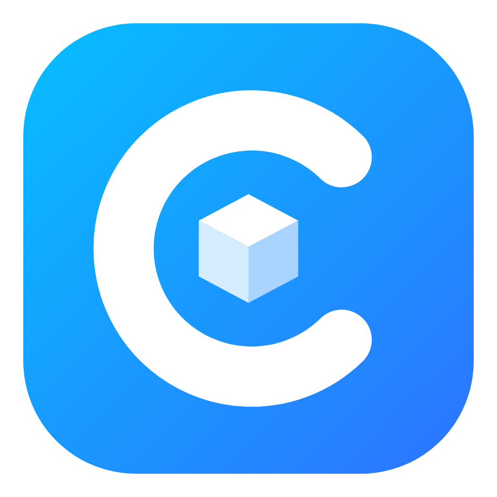</p>

<h1 align="center">Caskit</h1>

<p align="center"><b>免费开源的 CS2 储物柜（Storage Unit）与库存管理器。</b><br>
快速转移、汰换合同概率、印花、商店、市场和 Steam 令牌——同时管理多个账户。<br>
无订阅、无第三方服务器：一切都在你的电脑上运行，直接与 Steam 通信。</p>

<p align="center">
<a href="https://github.com/pythonMaster2002/cs2-storage-manager/releases/latest"></a>
<a href="https://github.com/pythonMaster2002/cs2-storage-manager/releases"></a>


<a href="https://ko-fi.com/mikidjus"></a>
</p>

<p align="center">
<a href="../README.md">English</a> ·
<a href="README.ru.md">Русский</a> ·
<a href="README.uk.md">Українська</a> ·
<a href="README.de.md">Deutsch</a> ·
<a href="README.es.md">Español</a> ·
<a href="README.pt.md">Português</a> ·
<a href="README.fr.md">Français</a> ·
<a href="README.pl.md">Polski</a> ·
<a href="README.tr.md">Türkçe</a> ·
<b>简体中文</b>
</p>

<p align="center">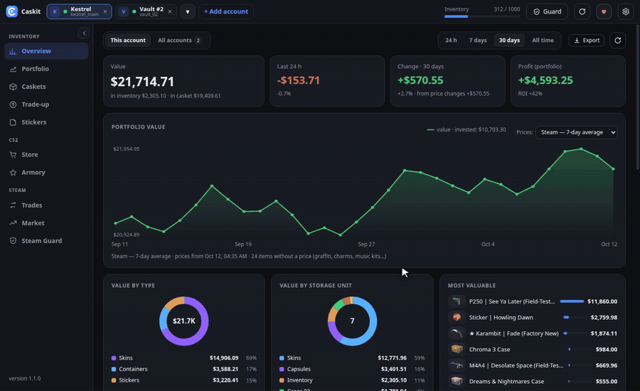</p>

> **之前用过 Casemove？** Casemove 现在会显示停用通知：*«Casemove has been replaced by Skinledger… Prices, images and items will break in Casemove eventually»*（[源码](https://github.com/nombersDev/casemove/blob/main/src/renderer/components/content/shared/infoModal.tsx)）。Skinledger 是付费服务：免费版只能移动物品，快速转移、商店购买、汰换合同、军械库、更多账户、交易和市场功能需每月 9.99–24.99 美元订阅（[常见问题](https://skinledger.com/#frequently-asked-questions)、[价格](https://skinledger.com/en/pricing-compare)，2026 年 10 月）。Caskit **免费**提供以上全部功能，无需在任何网站注册账户——并且开源。

## 功能

**储物柜（Storage Unit）**
- 批量存入和取出物品。速度会自动适应 Steam 的限制（通常每秒 8–13 件），卡住的物品会自动重试。
- **转移规则**：「所有箱子 → Cases 01、Cases 02…」、「印花 → Stickers」。一键执行或登录后自动执行。
- 重命名储物柜、隐藏已满的储物柜，并将全部内容导出为 JSON/CSV。

**价格与投资组合**
- 库存和储物柜值多少钱——按 Steam 7 日均价、Buff163 或 Skinport 价格，以你的货币显示；每日价值曲线以及涨跌最多的物品。
- **投资组合（盈亏）**：导入 Steam 市场记录，手动或通过 CSV 添加购买记录——平均买入价、未实现和已实现盈利（先进先出）。
- 价格来自每 12 小时下载一次的公开价格表；你的库存不会发送到任何地方。

**汰换合同**
- 可使用库存*和*储物柜中的物品（会自动取出）。
- 每种可能结果的**概率**、每件输入的磨损值、结果的**预测磨损值**，以及与输入成本对比的**期望价值**。
- 游戏不接受的物品（所属收藏品的最高品质）会提前标出。支持纪念品。
- 汰换后：合同的**盈利或亏损**、物品详情、**在游戏中检视**和**社区市场**。

**印花**
- 贴上、刮擦和移除印花——包括 CS2 自由放置的印花。
- 像游戏中一样的物品详情：10 位磨损值、图案种子、StatTrak™ 计数、名称标签和印花磨损；检视链接以及 Steam 库存中该物品的链接。

**CS2 商店与军械库**
- 购物车、收藏、钱包余额和购买后余额。每笔付款都由你确认。
- 军械库：用星星兑换奖励。
- 商品名称和图标会根据游戏文件自动更新。

**交易、社区市场与 Steam 令牌**
- 收到和发出的交易报价，接受/拒绝，自动接受礼物。
- 市场：在售、**带实时挂单簿和 30 日价格图的求购订单**、可搜索的历史记录、自动计算手续费的出售（也可直接从储物柜出售）。没有小数单位的货币（UAH、KZT、JPY……）会自动处理。
- 内置迷你 **SDA**：所有带 maFile 的账户的 Steam 令牌验证码、交易和上架确认、代理监控。

**账户与隐私**
- 同时登录多个账户，每个账户使用独立的 SOCKS5/HTTP 代理——在设置中配置和检测，或直接粘贴整个列表。账户可置顶并排序。
- 使用**二维码**（立即显示）、用户名和密码或 **maFile** 登录。
- **主播模式**（Ctrl+Shift+H）：登录名和昵称显示为“账户 1、2……”，隐藏余额，Steam 令牌验证码、交易对象和代理会被模糊——录视频、截图都安全。
- 10 种界面语言。更新仅在你同意后进行——也可以完全关闭。

## 截图

| | |
|---|---|
| 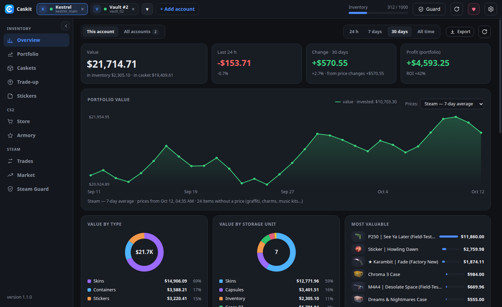 | 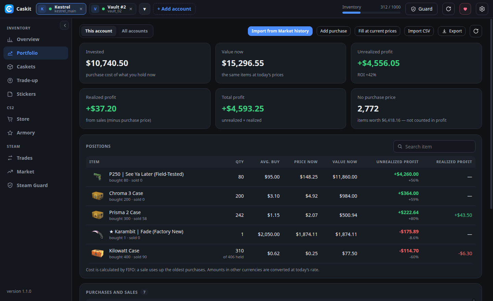 |
| **概览**：价值、曲线、最值钱的物品 | **投资组合**：盈亏（先进先出） |
| 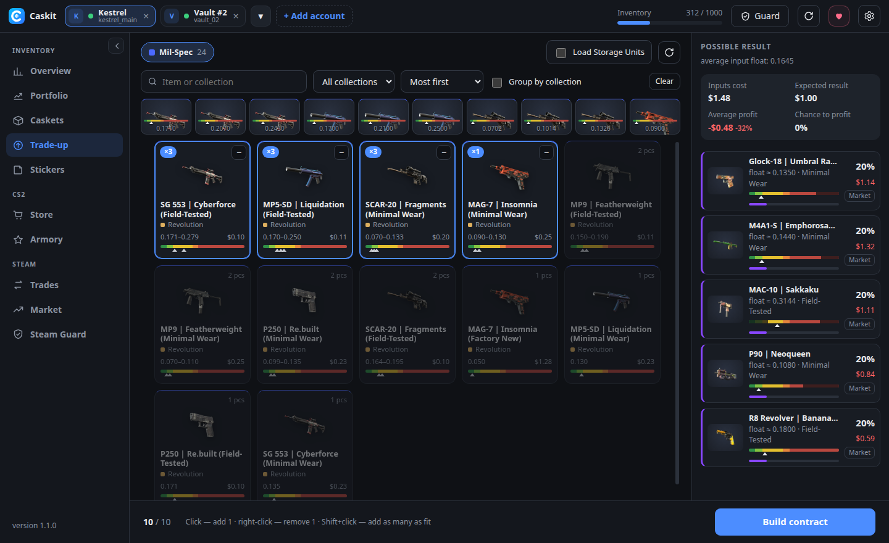 | 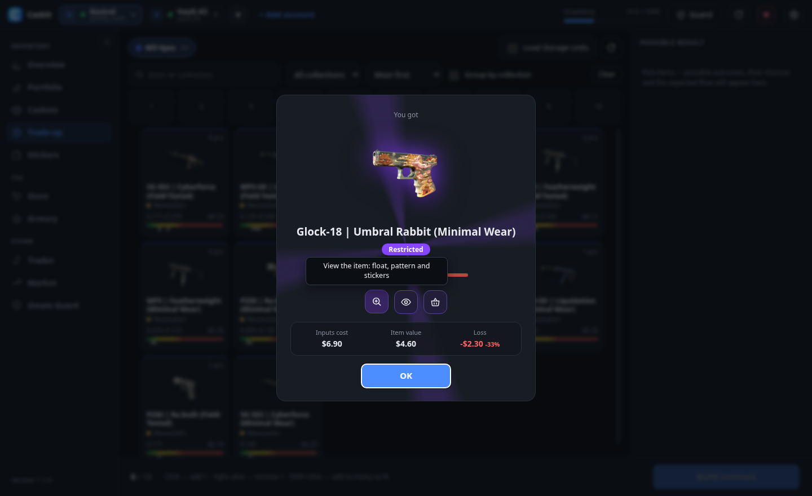 |
| **汰换合同**：结果、概率、期望价值 | **结果**：盈亏、查看、检视、市场 |
| 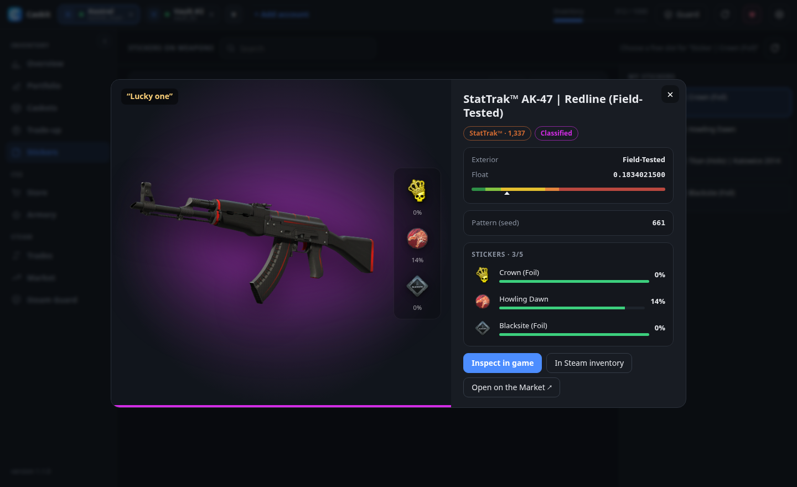 | 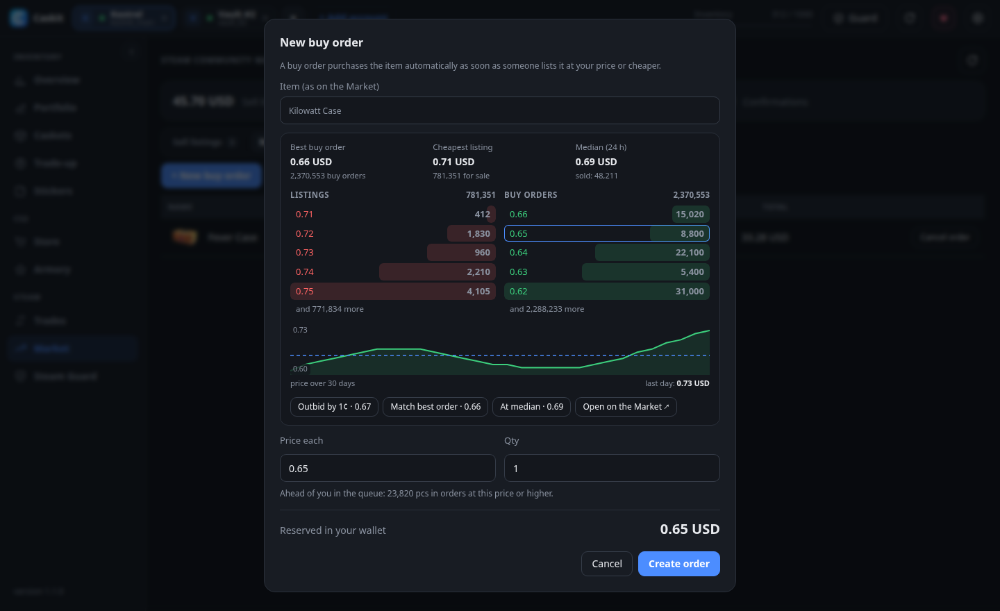 |
| **物品**：磨损、图案、印花 | **求购订单**：挂单簿和价格图 |
| 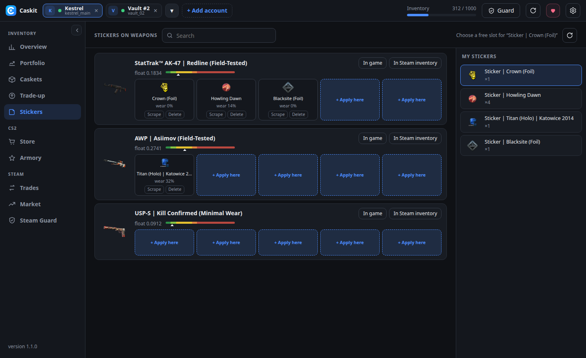 | 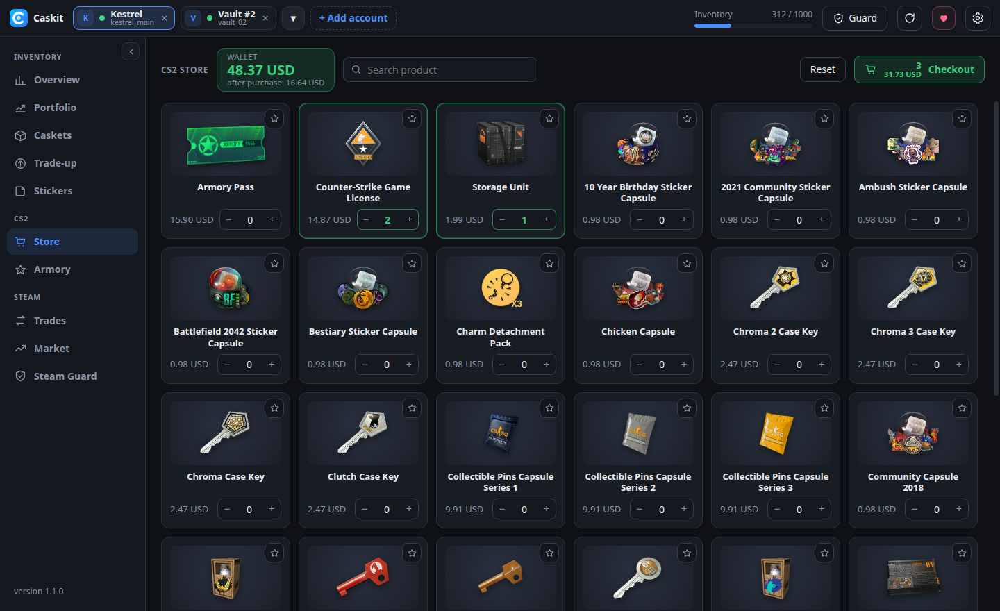 |
| **印花**：贴上、刮擦、移除 | **CS2 商店**：购物车与钱包 |
| 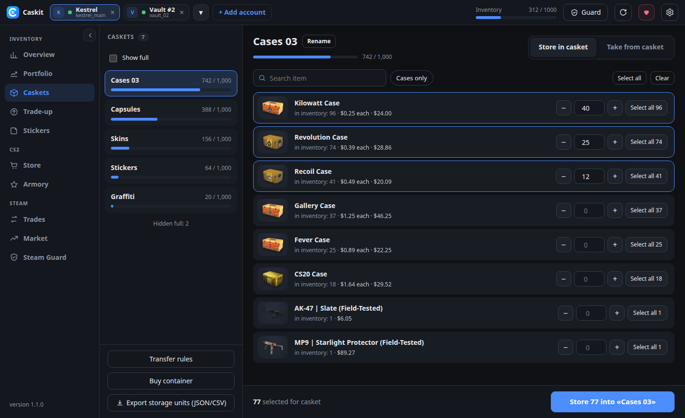 | 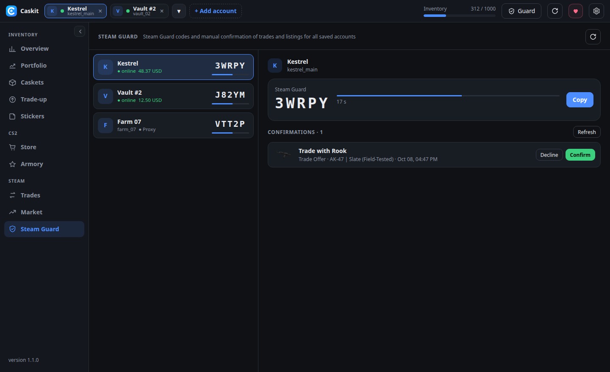 |
| **储物柜**：批量转移 | **Steam 令牌**：验证码与确认 |

## 下载

最新版本请见 **[Releases](https://github.com/pythonMaster2002/cs2-storage-manager/releases/latest)** 页面。

| 系统 | 文件 | |
|---|---|---|
| Windows | `Caskit-Setup-x.y.z.exe` | **推荐**——几秒完成安装，无需管理员权限，自动更新 |
| Windows | `Caskit-x.y.z-portable.exe` | 免安装（启动较慢，需手动更新） |
| macOS | `Caskit-x.y.z-arm64.dmg` (Apple Silicon) / `Caskit-x.y.z-x64.dmg` (Intel) | |
| Linux | `Caskit-x.y.z-x86_64.AppImage` 或 `Caskit-x.y.z-amd64.deb` | |

**首次启动。** 安装包尚未进行代码签名，系统可能会提示一次：

- **Windows**（「Windows 已保护你的电脑」）：点击 **更多信息 → 仍要运行**。
- **macOS**（「应用已损坏」/「无法验证」）：右键点击应用 → **打开**，或在终端执行 `xattr -cr "/Applications/Caskit.app"`。
- **Linux AppImage**：`chmod +x Caskit-*.AppImage`，然后运行。

**VirusTotal**：每个版本都会自动扫描——结果和链接位于每个[发布页面](https://github.com/pythonMaster2002/cs2-storage-manager/releases)底部。

### 卸载

- **Windows（安装版）**：设置 → 应用 → **Caskit** → 卸载。**便携版**：直接删除 `.exe` 即可。
- **macOS**：将 **Caskit** 从“应用程序”拖到废纸篓。
- **Linux**：删除 AppImage，或对 `.deb` 执行 `sudo apt remove caskit`。

已保存的登录信息和设置保留在数据文件夹中（见常见问题）——如需全部清除，请一并删除。

## 安全与隐私

- Caskit 只与 Steam（以及 CS2 游戏协调器）通信。密码从不保存；refresh token 和 maFile 密钥由系统**加密**后保存在你的磁盘上（Windows DPAPI / macOS 钥匙串 / Linux libsecret）。
- 如果账户设置了代理，该账户的*全部*流量都经过代理——网页请求、二维码、头像。代理不可用时，登录会中止，而不会直接连接。
- 本地 API 只监听 `127.0.0.1`，并要求只有应用窗口知道的随机令牌。
- 物品名称和图标每天从游戏文件的公开镜像更新一次（[GameTracking-CS2](https://github.com/SteamDatabase/GameTracking-CS2)、[counter-strike-image-tracker](https://github.com/ByMykel/counter-strike-image-tracker)）——不会发送任何账户数据。
- 无分析、无遥测。完整的网络连接列表见 **[隐私政策](../PRIVACY.md)**（英文）。

## 常见问题

**会被 VAC 封禁吗？** Caskit 不触碰游戏本身、游戏文件或内存，也不会启动 CS2。它以 Steam 客户端身份登录，像游戏自带的库存一样与 CS2 游戏协调器通信，VAC 不参与其中。但它仍是非官方工具，使用风险自负。

**Caskit 打开时可以玩游戏吗？** 如果在同一账户上启动 CS2，Steam 只会保留两个会话中的一个。请先在 Caskit 中退出该账户。

**自动更新安全吗？更新会不会坑我？** Caskit 从不自行下载或安装任何东西。有新版本时会先询问你——“更新”、“跳过此版本”或“以后再说”——在 设置 → 常规 → 更新 中选择“不检查”，就连检查也不会进行。更新只来自本仓库的 [Releases](https://github.com/pythonMaster2002/cs2-storage-manager/releases)：由 GitHub Actions 从公开代码构建（[workflow](../.github/workflows/release.yml)），经过 VirusTotal 扫描，安装程序在安装前会校验每个文件的 SHA-512。便携版永远不会自行更新。如果你不想信任任何现成的文件——可以自己构建 Caskit（见下文）。

**可以自己构建吗？** 可以——所需的一切都在本仓库中，见下方“从源码构建”。`:noupdate` 脚本会构建不含更新功能的版本：它甚至不会向 GitHub 查询新版本。

**数据保存在哪里？** 只在你的电脑上：`%APPDATA%\Caskit`（Windows）、`~/Library/Application Support/Caskit`（macOS）、`~/.config/Caskit`（Linux）。

## 支持项目

Caskit 永久免费。如果它为你节省了时间：

- ☕ [Ko-fi](https://ko-fi.com/mikidjus) — 银行卡或 PayPal
- 🎁 [赠送皮肤](https://steamcommunity.com/tradeoffer/new/?partner=146040317&token=Q_pa1oMK) — 任何多余的箱子或皮肤
- 💎 加密货币（Binance Pay / USDT）——地址见应用内 ♥ 按钮
- ⭐ 为仓库点亮星标

## 从源码构建

需要 Node.js 22+ 和 Git。

```bash
git clone https://github.com/pythonMaster2002/cs2-storage-manager
cd cs2-storage-manager
npm ci
npm start                      # 运行
npm run build:win              # 安装包 + 便携版 → dist/
npm run build:linux            # AppImage + deb
npm run build:mac              # dmg + zip（仅限 macOS）

# 同上但不含更新：不检查、不下载
npm run build:win:noupdate
npm run build:linux:noupdate
npm run build:mac:noupdate
```

**发布**：提高 `package.json` 中的 `version`，然后执行 `git tag vX.Y.Z && git push --tags`。GitHub Actions 会构建三个系统、发布到 Releases 并在 VirusTotal 上扫描 `.exe` 文件（密钥 `VT_API_KEY`）；已安装的副本会提示更新。

## 代码签名政策

Windows 版本由 GitHub Actions 从本仓库构建。计划通过 SignPath Foundation 签名（开源项目免费）；首次申请尚未获批，在此之前发布版本未签名。详情见 [Code signing policy](../README.md#code-signing-policy)（英文）。

## 许可证

[MIT](../LICENSE)

Caskit 是独立的开源项目，与 Valve Corporation 无关，也未获其认可。Counter-Strike、CS2 和 Steam 是 Valve Corporation 的商标。
